<picture>
  <source media="(prefers-color-scheme: dark)" srcset="./dark.svg">
  <source media="(prefers-color-scheme: light)" srcset="./light.svg">
  
</picture>

## Hey, I'm Sayak 👋

I'm a **B.Tech CSE (AI & ML)** student at **Sikkim Manipal Institute of Technology (SMIT)**, building across applied AI/ML, software engineering, and cloud-native systems — and learning in the open. I like turning fuzzy problems into tools that **detect, decide, and deploy**, and I care about evidence, correctness, and clean engineering over hype.

_·_SMIT-7C3AED?style=flat-square)

### 🎯 What I'm focused on

<table>
<tr>
<td width="50%" valign="top">

#### 🧠 Applied AI/ML
Computer vision, model training, and practical **inference pipelines** that hold up outside a notebook.

</td>
<td width="50%" valign="top">

#### 🔎 Retrieval-Augmented Generation
Evidence-**grounded answers** with citations — and honest **abstention** when the evidence is thin.

</td>
</tr>
<tr>
<td width="50%" valign="top">

#### 🛡️ Security &amp; Forensics
**Tamper-evident**, offline-first integrity checks and forensic heuristics.

</td>
<td width="50%" valign="top">

#### ☁️ Cloud-Native Engineering
**Containers, CI/CD, and GitOps** — shipping software the reproducible way.

</td>
</tr>
</table>

### 🧩 Selected Projects

<table>
<tr>
<td width="50%" valign="top">

#### 🛰️ [SAKSHYA](https://github.com/sayaksatpathi/SAKSHYA)
Vendor-agnostic **CCTV forensic evidence platform** — evidence ingestion, AI triage, cross-camera re-ID, deleted-clip recovery, and a tamper-evident cryptographic chain-of-custody. FastAPI + React, CI-green with a full test suite.

  

</td>
<td width="50%" valign="top">

#### 🔎 [RAGBench](https://github.com/sayaksatpathi/RAGBench)
Adaptive **RAG platform + evaluation harness** — grounded answers with citations, abstention when evidence is thin, and retrieval-strategy comparisons *(result on the evaluated corpus is neutral/tied, by design)*.

  

</td>
</tr>
<tr>
<td width="50%" valign="top">

#### ⚙️ [OpsForge](https://github.com/sayaksatpathi/opsforge-platform)
Cloud-native **DevSecOps & SRE platform** — code → test → sign → GitOps deploy → observe, with SLOs, burn-rate alerting, tracing, and chaos. Operator-verified on real AWS + a kind cluster.

  

</td>
<td width="50%" valign="top">

#### 🛡️ [Log-Guardian](https://github.com/sayaksatpathi/Log-Guardian)
Offline-first **log-integrity monitor** with forensic heuristics — streaming scans, timestamp-anomaly detection, baseline analysis, tamper-evident commitments, and a CLI.

  

</td>
</tr>
<tr>
<td width="50%" valign="top">

#### 🚁 [AeroMinds](https://github.com/sayaksatpathi/AeroMinds)
**Aerial waste intelligence** — a fine-tuned **YOLOv8** detector that spots illegal dumping from drone footage and scores severity. 🏆 *ELCIA Next-Gen Tech Hackathon — 2nd Runner-Up (top 3 of 180+ teams).*

  

</td>
<td width="50%" valign="top">

#### ☁️ [AWS EKS GitOps Lab](https://github.com/sayaksatpathi/AWS-EKS-GitOps-Production-Lab-)
Production-style **Kubernetes GitOps** on real AWS — EKS provisioned with Terraform, CI/CD via GitHub Actions + OIDC, Argo CD delivery, Prometheus/Grafana/Loki observability, and demonstrated rollback.

  

</td>
</tr>
</table>

### 🛠️ Tech Stack

**Languages** 
  
**AI / ML · Web** 
  
**Cloud · DevOps · Tools** 

> I use these at a student-builder level — comfortable *working with* the core set (Python, FastAPI, React/TS, Docker), and actively *exploring* cloud-native tooling (Kubernetes, GitOps, MLOps). Also: scikit-learn · NumPy · pandas · Streamlit.

### 🖥️ From my terminal

### 🌱 Open-Source Contributions

 

**Merged into upstream projects** 🟢

| Project | What I fixed | PR |
|---------|--------------|----|
| **mlflow/mlflow** | `format_prompt` was replacing placeholders that appear inside variable values | [#26807](https://github.com/mlflow/mlflow/pull/26807) |
| **ultralytics/ultralytics** | Skip `torch.compile` on CUDA when Triton is unavailable | [#26701](https://github.com/ultralytics/ultralytics/pull/26701) |
| **kubernetes-client/python** | Relax the `certifi` lower bound and stop Dependabot raising it | [#2745](https://github.com/kubernetes-client/python/pull/2745) |
| **cloud-custodian/cloud-custodian** | Skip `ROLLBACK_COMPLETE` stacks in AWS CFN tag actions | [#11215](https://github.com/cloud-custodian/cloud-custodian/pull/11215) |
| **aws-cloudformation/cfn-lint** | Validate `--registry-schemas` types against their schema | [#4763](https://github.com/aws-cloudformation/cfn-lint/pull/4763) |
| **aws-cloudformation/cfn-lint** | Check the length of a `Description` that uses a dynamic reference | [#4765](https://github.com/aws-cloudformation/cfn-lint/pull/4765) |

**In review (open PRs)** 🟡

- **KServe** — Python-client fixes: [#6405](https://github.com/kserve/kserve/pull/6405) · [#6407](https://github.com/kserve/kserve/pull/6407) · [#6414](https://github.com/kserve/kserve/pull/6414) · [#6521](https://github.com/kserve/kserve/pull/6521)
- **mlflow/mlflow** — always load model config as UTF-8: [#27008](https://github.com/mlflow/mlflow/pull/27008)
- **kubeflow/docs-agent** — [#283](https://github.com/kubeflow/docs-agent/pull/283) · [#285](https://github.com/kubeflow/docs-agent/pull/285)

All links are public PRs — browse everything on my <a href="https://github.com/sayaksatpathi">profile</a>.

### 📊 GitHub Stats, Grade &amp; Contributions

<!-- Scorecard with letter grade (rank) -->

 

<!-- Commits / PRs / issues / contributions + total contributions & streak -->

 

<!-- Extras: commits by language + when I'm most productive -->

### 🐍 Contribution Graph

<!--
  Snake self-hosted on this repo's `output` branch (generated by the workflow) — always available.
  One-time setup if you ever reset it: Settings → Actions → General → Workflow permissions →
  "Read and write permissions", then run "Generate Contribution Snake" once.
-->
<picture>
  <source media="(prefers-color-scheme: dark)" srcset="https://raw.githubusercontent.com/sayaksatpathi/sayaksatpathi/output/github-snake-dark.svg">
  <source media="(prefers-color-scheme: light)" srcset="https://raw.githubusercontent.com/sayaksatpathi/sayaksatpathi/output/github-snake.svg">
  
</picture>

### 🔗 Connect

---

### ✨ Thanks for visiting my profile! ✨

**If you made it this far — let's build something great together.** 🚀

…and yes, that little guy is <b>Shinchan</b>, drawn entirely in Python <code>turtle</code> — <a href="scripts/shinchan_turtle.py">source</a>. 🖍️

 

