<picture>
  <source media="(prefers-color-scheme: dark)" srcset="./dark.svg">
  <source media="(prefers-color-scheme: light)" srcset="./light.svg">
  
</picture>

## Hey, I'm Sayak 👋

I'm a **B.Tech CSE (AI & ML)** student at **Sikkim Manipal Institute of Technology (SMIT)**, building across applied AI/ML, software engineering, and cloud-native systems — and learning in the open. I like turning fuzzy problems into tools that **detect, decide, and deploy**, and I care about evidence, correctness, and clean engineering over hype.

### 🎯 What I'm focused on

- **Applied AI/ML** — computer vision, model training, and practical inference pipelines.
- **Retrieval-Augmented Generation** — grounded answers with citations and honest abstention.
- **Security & forensics tooling** — tamper-evident, offline-first integrity checks.
- **Cloud-native engineering** — containers, CI/CD, and GitOps workflows.

### 🧩 Selected Projects

<table>
<tr>
<td width="50%" valign="top">

#### 🛡️ [Log-Guardian](https://github.com/sayaksatpathi/Log-Guardian)
Offline-first **log-integrity monitor** with forensic heuristics — streaming scans, timestamp-anomaly detection, baseline analysis, tamper-evident commitments, and a CLI.

  

</td>
<td width="50%" valign="top">

#### 🔒 [Evidence Protector](https://github.com/sayaksatpathi/Evidence_protector)
Full-stack distribution of the **same integrity engine** as Log-Guardian — FastAPI backend, web UI, Docker Compose, and release-evidence tooling.

  

</td>
</tr>
<tr>
<td width="50%" valign="top">

#### 🔎 [RAGBench](https://github.com/sayaksatpathi/RAGBench)
Adaptive **RAG platform + evaluation harness** — grounded answers with citations, abstention when evidence is thin, and retrieval-strategy comparisons *(result on the evaluated corpus is neutral/tied, by design)*.

  

</td>
<td width="50%" valign="top">

#### 🛰️ [CyberShield AI](https://github.com/sayaksatpathi/cybershield-ai-streamlit)
**ML fraud-detection** web app — CSV upload, model-based scoring, and an analytics dashboard.

  

</td>
</tr>
<tr>
<td width="50%" valign="top">

#### ⏳ [TimeCraft](https://github.com/sayaksatpathi/TimeCraft)
**Productivity workspace** — tasks, calendar, focus timer, analytics, and an assistant interface.

  

</td>
<td width="50%" valign="top">

#### ✏️ [Shinchan, in code](./shinchan.svg)

A little **Shinchan drawn entirely in Python `turtle`** — hand-plotted paths, rendered to a crisp SVG. Because engineering can be playful too.

  

</td>
</tr>
</table>

### 🛠️ Tech Stack

**Languages** 
  
**AI / ML · Web** 
  
**Cloud · DevOps · Tools** 

> I use these at a student-builder level — comfortable *working with* the core set (Python, FastAPI, React/TS, Docker), and actively *exploring* cloud-native tooling (Kubernetes, GitOps, MLOps). Also: scikit-learn · NumPy · pandas · Streamlit.

### 🌱 Open Source

> **Kubeflow Pipelines — [#14919](https://github.com/kubeflow/pipelines/issues/14919)** &nbsp;·&nbsp; *work in progress*
> Investigating misleading local-pipeline error chains; a focused test run passes locally. **Not yet merged** — tracking it openly.

You can browse everything I'm doing on my **[public contributions](https://github.com/sayaksatpathi)**.

### 🐍 GitHub Activity

<!--
  Snake self-hosted on this repo's `output` branch (generated by the workflow) — always available.
  One-time setup if you ever reset it: Settings → Actions → General → Workflow permissions →
  "Read and write permissions", then run "Generate Contribution Snake" once.
-->
<picture>
  <source media="(prefers-color-scheme: dark)" srcset="https://raw.githubusercontent.com/sayaksatpathi/sayaksatpathi/output/github-snake-dark.svg">
  <source media="(prefers-color-scheme: light)" srcset="https://raw.githubusercontent.com/sayaksatpathi/sayaksatpathi/output/github-snake.svg">
  
</picture>

 

Stats cards are served by a third-party; if one is slow to load, the snake above always renders.

### 🔗 Connect

